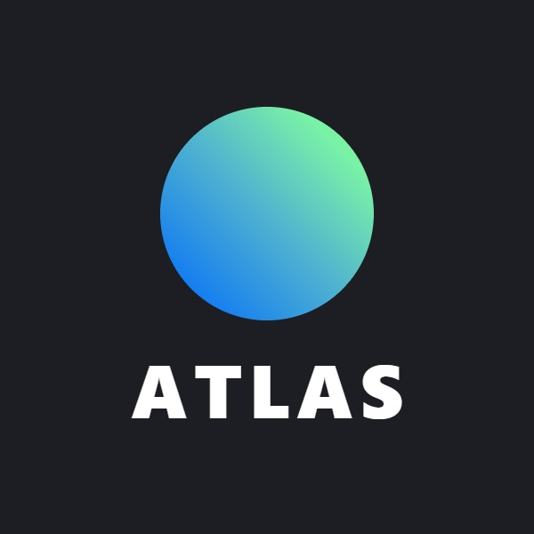
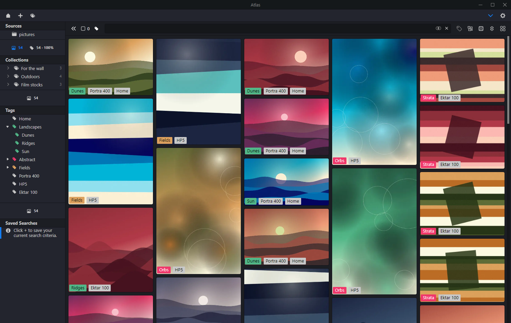
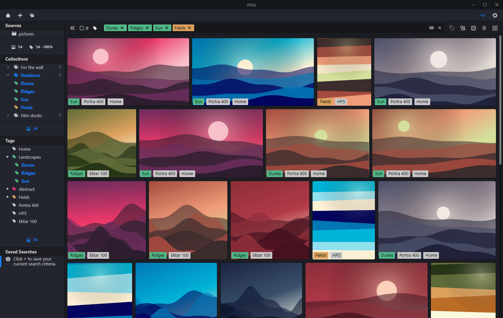
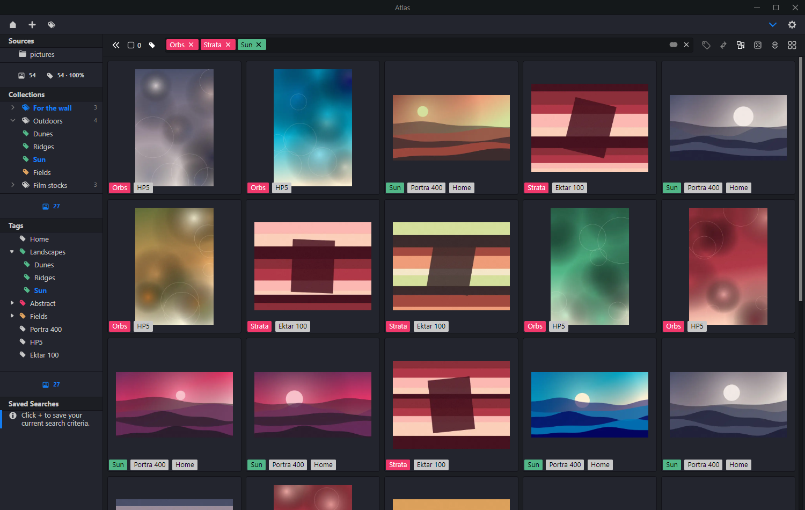
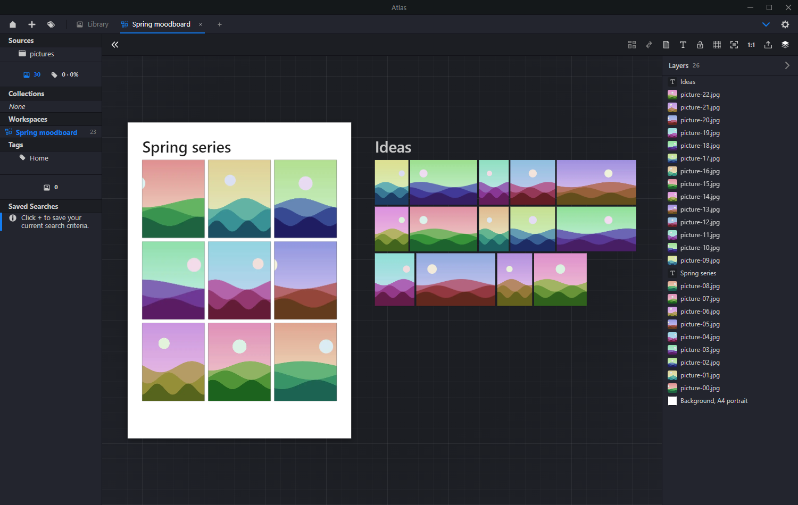
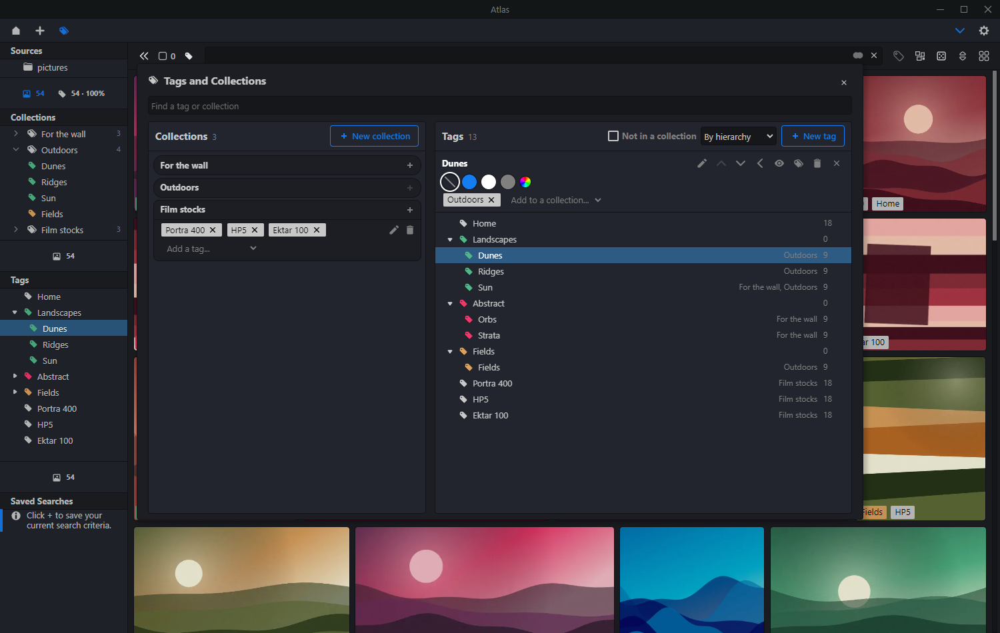

# Atlas

Atlas is a desktop app for browsing, tagging and arranging a library of photographs, digital and film.
It reads your image folders and never changes them: tags, collections and orderings live in Atlas's own
database, next to your files rather than inside them.



Atlas is a personal fork of [Allusion](https://github.com/allusion-app/Allusion) 1.0.0-rc.10, the visual
library manager made by the [Allusion team](https://allusion-app.github.io/). Everything Atlas does is built
on their work, and it is released under the same licence, GPL-3.0.

## What Atlas adds to Allusion

**It leaves your files alone**

- Writing metadata into files, moving files to the trash and moving files between folders are switched
  off. The only thing Atlas can create inside a folder of yours is a new, empty folder, and only when you
  ask for one.

**Faster with large libraries**

- Thumbnails for the whole library are made in the background, so scrolling does not wait for them.
- Large tiles are drawn at exactly the size they are shown, instead of loading the full original.
- Start-up no longer waits for ExifTool; TIFF files open without freezing the window.
- Photos taken with the camera turned sideways are laid out with their real shape.

**Organising**

- **Sources**: the folders Atlas watches (called Locations in Allusion), with a count of images and of
  tagged images for the folder that is open.
- **Collections**: named groups of tags. Opening one shows the images of all its tags.
- **Tags and Collections page**: one place to rename, colour, nest, merge and delete tags and to build
  collections. Tag colours can follow the theme.
- **Home gallery**: the images tagged `Home`, shown when Atlas starts.
- **Workspaces**: endless canvases, one per tab, made from what the Library shows and laid out the same
  way, or filled by dragging tags, collections, folders and images onto them. Move, stack and size
  images, add texts and paper sheets, snap to edges, middles and even gaps, arrange a selection in rows,
  columns or a grid (whole or cut to 1:1 or 4:5), copy between workspaces, reorder layers, and save as a
  picture at the full resolution of the photos. Zoom from thousands of images at a glance to one at full
  size.
- **Collage mode**: put the images of any view in your own order by dragging them, or switch two.
- **Export**: copy selected or tagged images to a folder you pick.
- **Folder creator**: make a run of numbered or dated folders, continuing the numbering already there.

**Looking**

- **Screensaver**: after the computer has been idle, a moving wall of the images of the tags and
  collections you choose, on every monitor.
- Twelve colour themes, a shuffle button, and a bar that can be hidden to give the images more room.

## A look around

A collection open in the horizontal masonry view:



Collage mode, where every image has a slot of its own and can be dragged to another place:



A workspace: a grid cut to 4:5 on a sheet of paper, a second batch beside it, and the layers on the right:



The page for editing tags and collections:



The pictures in these screenshots are generated, not photographs.

## Running it

There are no installers yet: Atlas is run from source.

You need [Node.js](https://nodejs.org/en/download/) 20 and [Yarn](https://classic.yarnpkg.com/) 1.

```
git clone https://github.com/mibrzozek/Atlas.git
cd Atlas
yarn install
yarn dev        # builds into /build and keeps rebuilding on every change
yarn start      # in a second terminal: starts Atlas
```

Reload the window (Ctrl/Cmd + R) after a change. Changes to `src/main.ts` need a restart.

| Command | What it does |
|---|---|
| `yarn dev` | Watch build |
| `yarn start` | Start Atlas |
| `yarn oobe` | Start Atlas as a new user, with an empty throwaway profile |
| `yarn test` | Run the tests |
| `yarn package` | Build an installer for your platform into `/dist` |

Atlas is developed and tested on Windows. The Mac and Linux support inherited from Allusion is still in
the code, but nobody has run this fork there.

## Coming from Allusion

Atlas can read an Allusion library: in Allusion, make a backup under Settings → Import/Export, then
restore that file in Atlas under the same menu. Tags, saved searches and locations come along. A backup
made in Atlas can be restored into Allusion too; collections then show up there as saved searches.

## Things to know

- Camera raw files (CR2, CR3 and the like) are not shown yet.
- The updater and the "report a bug" link still point at the Allusion project. Do not rely on automatic
  updates.
- Atlas runs on Electron 21, which no longer receives security updates. It only opens your own local
  files; do not point it at untrusted content.

## Working on the code

[`CLAUDE.md`](./CLAUDE.md) is the working guide: the rules (the image files are never touched), how the
code is laid out, how changes are verified, and what is easy to break.

## Licence and credit

GPL-3.0, like Allusion. See [`LICENSE`](./LICENSE).

Allusion is the work of the Allusion team: <https://github.com/allusion-app/Allusion>.
